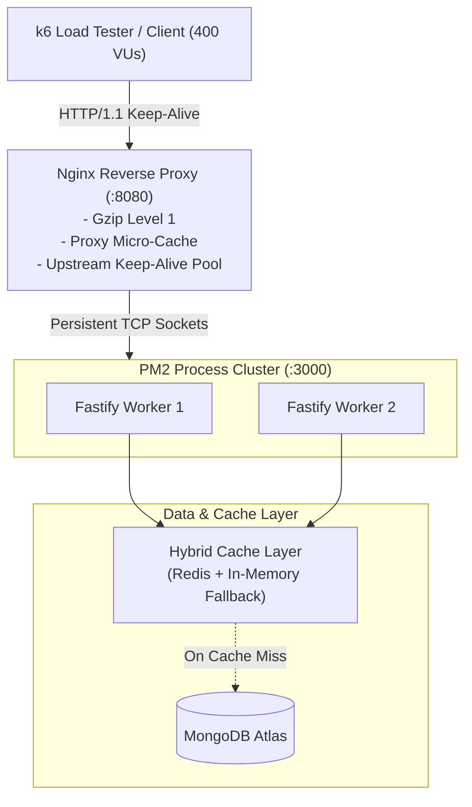

# BookMyShow - High-Throughput System Design & Performance Engineering

> A high-performance, distributed system design and implementation of an online ticket booking platform built with **Node.js, Fastify, TypeScript, Redis, MongoDB, PM2, and Nginx**.

---

## 🚀 The Scaling Journey: 6.7k to 478k Req/Min

Rather than just writing basic CRUD APIs, this project systematically benchmarks, analyzes, and eliminates bottlenecks across the entire request lifecycle.

Under heavy load simulation (**400–500 concurrent virtual users**) on a consumer-grade developer workstation (**12 GB RAM**), throughput was optimized by **~71x**:

| Iteration | Architecture Stage | Throughput | Latency | Engineering Focus |
| :--- | :--- | :--- | :--- | :--- |
| **Stage 1** | Baseline (Single-Thread Node.js + DB Query) | **6,700 req/min** (~111 RPS) | High | Direct database queries bound by disk I/O and un-cached parsing |
| **Stage 2** | Application Cache-Aside Layer ([cache.util.ts](file:///E:/Projects/System-Design/Book-my-show/src/shared/utils/cache.util.ts)) | **300,000 req/min** (~5,000 RPS) | Low | In-memory / Redis cache eliminating repeated database lookups |
| **Stage 3** | Multi-Core Process Clustering ([PM2](file:///E:/Projects/System-Design/Book-my-show/ecosystem.config.cjs)) | **300k+ req/min** | **~10 ms** | Bypassing Node.js single-thread limits via CPU cluster & round-robin scheduling |
| **Stage 4** | Reverse Proxy Edge Optimization ([Nginx](file:///E:/Projects/System-Design/Book-my-show/nginx-windows.conf)) | **478,000 req/min** (~7,966 RPS) | **Sub-10ms** | Upstream keepalive socket pooling, Gzip Level 1, and micro-caching |

---

## 🏛️ High-Throughput Architecture



---

## 🔬 Key Engineering Challenges & Solutions

### 1. Database I/O Elimination
- **Challenge**: Direct queries to MongoDB for frequently accessed read paths (e.g., `/api/v1/cities`, active cinemas) saturated the connection pool and throttled throughput at 6,700 req/min.
- **Solution**: Built a hybrid **Cache-Aside** utility ([src/shared/utils/cache.util.ts](file:///E:/Projects/System-Design/Book-my-show/src/shared/utils/cache.util.ts)) featuring primary Redis caching with an automatic, bounded in-memory RAM fallback and TTL auto-expiration.

### 2. Overcoming Node.js Single-Thread Constraint
- **Challenge**: Node.js operates on a single-threaded event loop per process, leaving multi-core CPU capacity underutilized.
- **Solution**: Implemented process clustering with **PM2** ([ecosystem.config.cjs](file:///E:/Projects/System-Design/Book-my-show/ecosystem.config.cjs)), distributing incoming network traffic across CPU cores with round-robin scheduling (`NODE_CLUSTER_SCHED_POLICY: 'rr'`), dropping average request latency to ~10ms.

### 3. Mitigating TCP Socket Churn & Proxy Overhead
- **Challenge**: At 5,000+ RPS, ephemeral port exhaustion and TCP handshake overhead degrade reverse proxy performance.
- **Solution**: Configured **Nginx** ([nginx-windows.conf](file:///E:/Projects/System-Design/Book-my-show/nginx-windows.conf)) with:
  - `upstream backend { keepalive 64; }` to maintain persistent socket pools to Fastify workers.
  - Cleared `proxy_set_header Connection ""` to ensure upstream connections stay open.
  - Native `gzip_comp_level 1` balancing bandwidth compression against CPU usage.
  - Shared memory edge micro-caching (`proxy_cache api_cache`).

---

## 🛠️ Tech Stack & Tooling

- **Runtime & Framework**: Node.js, [Fastify](https://fastify.dev/) (minimal overhead & fast schema-based JSON serialization)
- **Language**: TypeScript (Strict mode, ES Modules)
- **Linter**: Oxlint
- **Process Manager**: PM2 (Cluster Mode)
- **Reverse Proxy**: Nginx (Edge micro-cache & persistent socket pooling)
- **Databases**: MongoDB (Mongoose), Redis (ioredis)
- **Benchmarking**: [k6](https://k6.io/)

---

## 🚦 How to Run & Reproduce Benchmarks

### 1. Installation
```bash
pnpm install
pnpm build
```

### 2. Start PM2 Cluster
```bash
pnpm cluster:start
# Check status: pnpm cluster:monit
```

### 3. Start Nginx
```bash
pnpm nginx:start
```

### 4. Execute k6 Load Test
```bash
pnpm test:k6
```
